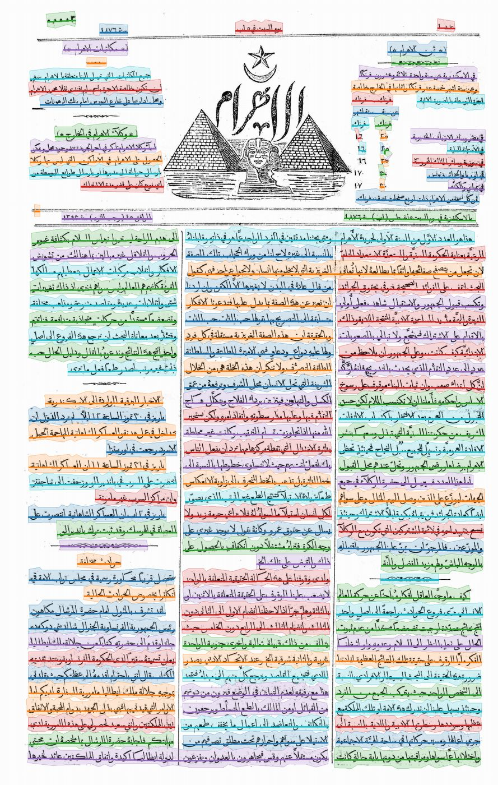
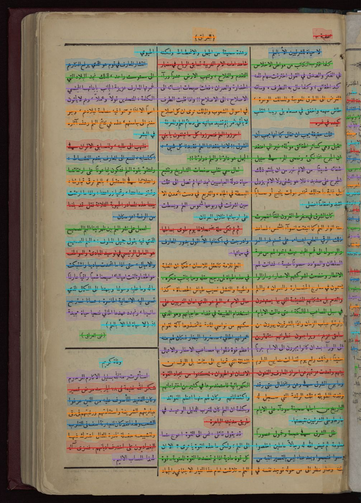
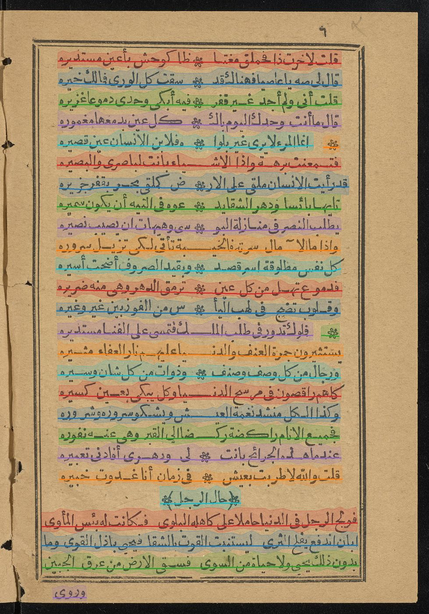
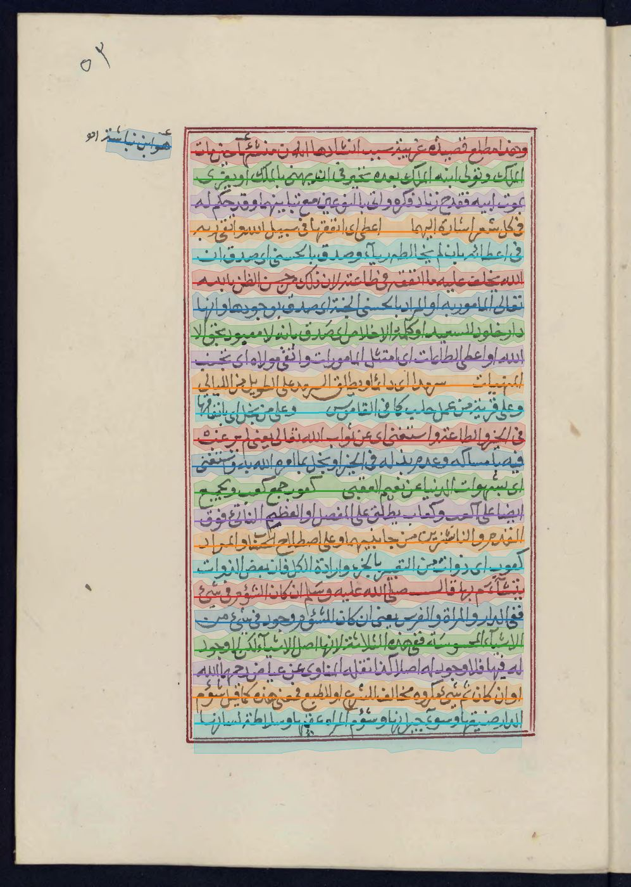

# Jamil

Text line detection for Arabic-script documents, written from scratch in Rust
with its own trained model. Its line tracing follows
[Kraken](https://github.com/mittagessen/kraken)'s algorithm, so it can also run
Kraken models.

Jamil finds every line of text on a page image: its baseline, its outline,
the page's text regions and the reading order. It comes with its own trained
model for Arabic-script pages — printed books, manuscripts, newspapers,
tables, verse and marginal notes.

- **A command and a Python module**; neither needs PyTorch or Kraken installed.
- **Its own model built in**, and [fine-tunable](train/README.md) on your
  own pages.
- **Kraken models work too**: given one, Jamil returns the same lines Kraken
  does, checked stage by stage, in a fraction of the time.

## On pages

Lines found by Jamil's built-in model. Each line's outline is shaded and its
baseline drawn on top, one colour per line in reading order. The pages are
public domain, from Wikimedia Commons; [`docs/draw.py`](docs/draw.py) draws
them from Jamil's output.

<table>
<tr>
<td width="50%"><a href="docs/examples/newspaper-al-ahram-1876.jpg"></a><br>
<a href="https://commons.wikimedia.org/wiki/File:Al-Ahram,1,Aug,05,1876.pdf"><em>Al-Ahram</em>, first issue, 1876</a>: three columns under a masthead.</td>
<td width="50%"><a href="docs/examples/newspaper-al-iraq-1920.jpg"></a><br>
<a href="https://commons.wikimedia.org/wiki/File:Al-Iraq,_Number_1,_June_1,_1920_WDL10097.pdf"><em>Al-Iraq</em>, first issue, 1920</a>: columns on paper gone brown, a page of a bound volume.</td>
</tr>
<tr>
<td><a href="docs/examples/verse-marrash-1881.jpg"></a><br>
<a href="https://commons.wikimedia.org/wiki/File:(Frans%C4%ABs)_Fat%E1%B8%A5_All%C4%81h_Marr%C4%81sh_%E2%80%93_Kit%C4%81b_Gh%C4%81bat_al-%E1%B8%A4aqq_%26_Mashhad_al-A%E1%B8%A5w%C4%81l_(Cairo,_1881)_%E2%80%93_Volume_2_(Mashhad_al-A%E1%B8%A5w%C4%81l).pdf">Fatḥ Allāh Marrāsh, <em>Mashhad al-Aḥwāl</em>, Cairo 1881</a>: verse, each verse one line across the blank between its halves.</td>
<td><a href="docs/examples/manuscript-ajaib-al-makhluqat.jpg"></a><br>
<a href="https://commons.wikimedia.org/wiki/File:Kit%C4%81b%27Aj%C4%81%27ib_al-makhl%C5%ABq%C4%81t_wa-ghar%C4%81%27ib_al-mawj%C5%ABd%C4%81t_(1750).pdf"><em>ʿAjāʾib al-makhlūqāt</em>, a manuscript of 1750</a>: writing beside a painting.</td>
</tr>
<tr>
<td><a href="docs/examples/manuscript-hifni-1888.jpg"></a><br>
<a href="https://commons.wikimedia.org/wiki/File:Glosses_of_al-Hifn%C4%AB_on_the_Y%C4%81sam%C4%ABn%C4%AByya_WDL3222.pdf">al-Ḥifnī's glosses on the <em>Yāsamīnīyya</em>, a manuscript of 1888</a>: a hand, with a heading in the margin.</td>
<td></td>
</tr>
</table>

## Use

```bash
cargo build --release
```

The network runs in [ONNX Runtime](https://onnxruntime.ai), found at run time:
`ORT_DYLIB_PATH` names its shared library (`pip install onnxruntime-gpu` puts
one under `site-packages/onnxruntime/capi/`). For the GPU, the CUDA and cuDNN
libraries it links must be on `LD_LIBRARY_PATH`.

```bash
ORT_DYLIB_PATH=/path/to/libonnxruntime.so ./target/release/jamil page.png
```

That reads with the network Jamil carries. A model named before the pages
reads them instead: a Kraken model (`.safetensors`) or a network exported
from [`train/`](train/README.md) (`.onnx`).

One JSON object a page: `lines` in reading order, each with a `baseline` and a
closed `boundary` in the page's pixels, and `regions`. `--out DIR` writes a
file a page; `--device cpu` keeps off the GPU; `--ltr` reads columns from the
left.

Given several pages it reads them as a pipeline — one being opened while
another is in the network and a third is traced — and answers in the order
given. A page that cannot be read is reported and the rest go on.

`--mend` joins the pieces a line was left in where the network was unsure of
it — faint handwriting, mostly — going by the network's own marks for where a
line ends. The lines are then no longer Kraken's to the point, so it is off
unless asked for.

Two options trade Kraken's arithmetic for speed on a GPU, for Kraken's
models: `--tf32` rounds the convolutions as PyTorch rounds them by default, and
`--half` runs them in half precision. Both move some baselines a pixel.

## From Python

```python
import jamil

model = jamil.Model()                          # the network Jamil carries; or a path to a model
page = model.segment("page.png")               # or a Pillow image, or a uint8 array
for line in page.lines:                        # in reading order
    line.baseline, line.boundary               # [[x, y], …] in the page's pixels
pages = model.segment_many(paths_or_images)    # a pile, as a pipeline; same answers
page = model.segment("page.png", mend=True)    # broken lines joined: not Kraken's, better
```

What comes back is laid out as Kraken's `Segmentation`: `lines` of
`BaselineLine` (`id`, `baseline`, `boundary`, `tags`, `regions`), `regions`
by kind, `text_direction`, `imagename` — and `size` and `seconds` besides.
Code written against `kraken.blla.segment` reads it as it stands, and
`page.to_kraken()` makes Kraken's own objects of it for `rpred` or a
serializer. `jamil.segment(image, model=model)` is the method called the way
Kraken's function is. The module needs neither Kraken nor PyTorch.

- **Columns are read from the right unless told**: `text_direction` is
  `"horizontal-rl"` by default, as the command reads. Kraken's default is
  `"horizontal-lr"`.
- **ONNX Runtime is found for you** where `pip install onnxruntime-gpu` puts
  it, and the GPU's libraries are loaded from the `nvidia-*` wheels, so there
  is nothing to set; `ORT_DYLIB_PATH` still names another. `model.on_gpu`
  says where the network runs, and a model that wanted a GPU and did not get
  one warns with the runtime's reason. (With `onnxruntime` and `onnxruntime-gpu` both installed the first
  wins, and it has no GPU in it.)
- **A Pillow image is fed as Kraken would feed it**, pixel for pixel. A path
  is opened here, by another decoder than Pillow's: the same for a PNG, a
  level off here and there for a JPEG.
- **`segment_many`** takes any iterable of paths, images and arrays, and asks
  each image for its pixels only a few pages ahead of the network. A page
  that cannot be read does not stop the rest: the call raises afterwards,
  naming it, or with `errors="none"` leaves `None` in its place.
- The interpreter's lock is let go of while a page is read. A model reads one
  call at a time.

To build it, with [maturin](https://www.maturin.rs) — `pip install ./python`
— or without:

```bash
cargo build --release -p jamil-py && cp target/release/libjamil_py.so python/jamil.abi3.so
```

and put `python/` on `PYTHONPATH`. One build serves every Python from 3.9 on.
It is built for the processor it is built on (`.cargo/config.toml`): take
`target-cpu=native` out before building one to pass around. The `maturin`
build is untested.

```bash
JAMIL_MODEL=MODEL.safetensors JAMIL_GOLDEN=GOLDEN_DIR PYTHONPATH=python pytest python/tests
```

## The model

The built-in network, `models/jamil-b1.onnx`, is compiled into the command
and the module. It is an EfficientViT-B1 encoder with a light decoder that
paints the same four heatmaps as a Kraken segmentation model (line starts,
line ends, baselines, text regions) at a quarter of the page's resolution.
Its PyTorch weights, `models/jamil-b1.safetensors`, are the starting point for
fine-tuning on your own pages: see [`train/README.md`](train/README.md).

Jamil also reads a Kraken segmentation model as Kraken 7 saves it
(`.safetensors`), its default model or one trained with `ketos segtrain`, with
nothing to export; and any network trained with [`train/`](train/README.md)
and exported as `.onnx`. `--tf32` and `--half` apply to Kraken models only; an
exported network runs with the arithmetic of its graph.

## Build and check

The check compares each stage with what Kraken made of the same heatmap. Dump
those once, under an environment with Kraken 7 installed:

```bash
python reference/dump_golden.py MODEL.safetensors GOLDEN_DIR cuda:0 page1.png page2.png
```

```bash
python reference/dump_outlines.py GOLDEN_DIR
```

```bash
./target/release/check GOLDEN_DIR
```

```bash
./target/release/check_outlines GOLDEN_DIR
```

```bash
./target/release/check_page GOLDEN_DIR
```

```bash
ORT_DYLIB_PATH=/path/to/libonnxruntime.so ./target/release/check_net GOLDEN_DIR MODEL.safetensors
```

```bash
JAMIL_GOLDEN=GOLDEN_DIR cargo test --release
```

## Licence

Apache 2.0. See [NOTICE](NOTICE).
